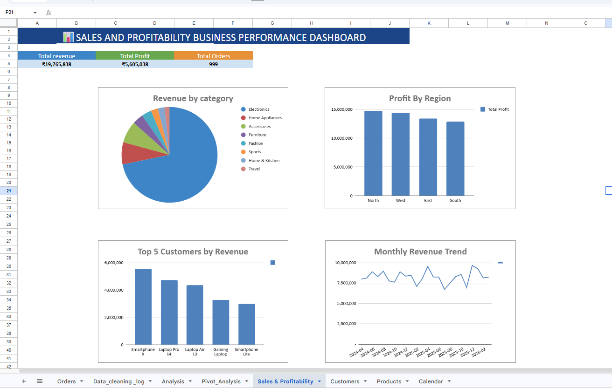
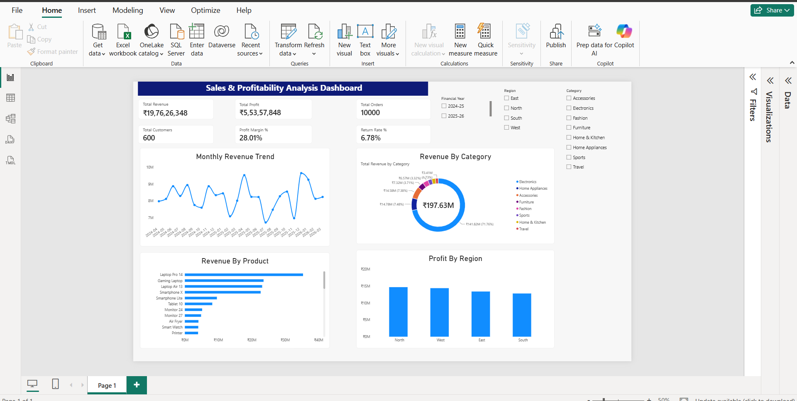

# Sales & Profitability Analytics: Identifying Revenue Leakage and Growth Opportunities

## Project Overview

This project analyzes e-commerce sales data from April 2024 to March 2026 to evaluate business performance, revenue growth, product profitability, customer behavior, discounts, returns, and regional sales performance.

The project uses SQL, Google Sheets, and Power BI to transform sales data into actionable business insights and recommendations.

## Business Objective

The main objective is to understand what drives revenue and profitability, identify top-performing products and categories, compare regional performance, and highlight opportunities to improve pricing, inventory planning, and overall business performance.

## Dataset Overview

The project includes sales transactions and supporting customer, product, and calendar data.

- **Orders:** 10,000 orders
- **Customers:** 600 customers
- **Products:** 40 products
- **Analysis period:** April 2024 – March 2026
- **Business dimensions:** Product, category, customer, city, region, discount, returns, and time

## Tools & Technologies

- **SQL:** Data analysis, aggregations, profitability calculations, customer analysis, and sales trends.
- **Google Sheets:** Data cleaning, calculated columns, Pivot Tables, KPI summaries, and dashboard creation.
- **Power BI:** Data modeling, DAX measures, KPI cards, interactive visualizations, and dashboard development.

## Data Cleaning & Preparation

The data preparation process included:

- Checking for duplicate order IDs and reviewing missing values.
- Checking date formats and data types.
- Reviewing product, category, city, and region values for consistency.
- Validating revenue, cost, profit, and discount-related fields.
- Creating financial year, month, and year-month fields for trend analysis.
- Calculating profit margin and preparing KPI summaries.
- Preparing data for analysis and visualization in Power BI.

## Key Performance Indicators (KPIs)

| KPI | Result |
|---|---:|
| Total Revenue | ₹197,626,348 |
| Total Profit | ₹55,357,848 |
| Total Orders | 10,000 |
| Total Customers | 600 |
| Profit Margin | 28.01% |
| Return Rate | 6.78% |

## Key Analysis

- Revenue and profit by product and category.
- Product-level profitability and profit margins.
- Revenue concentration across categories.
- Regional profit performance.
- Customer-level sales performance.
- Discount and return-rate analysis.
- Monthly revenue trends across the analysis period.

## Key Business Findings

### 1. Revenue Concentration

Electronics contributes approximately **71.8% of total revenue**, making it the leading category. This indicates that overall revenue is heavily concentrated in Electronics.

**Recommendation:** Maintain stock availability for top-selling products and monitor their profit margins to sustain revenue while protecting profitability.

### 2. Top Revenue-Generating Products

Laptop Pro 14 generates approximately **₹3.54 crore** in revenue, followed by Gaming Laptop at approximately **₹2.36 crore**. Laptop Air 13, Smartphone X, and Smartphone Lite are also among the leading products by revenue.

**Recommendation:** Prioritize inventory planning for high-performing products and evaluate their profitability, demand, and stock requirements before making pricing decisions.

### 3. Regional Profit Performance

The North region leads in total profit, followed by West, East, and South.

**Recommendation:** Investigate the factors contributing to the North region's performance and identify suitable strategies that could improve profitability in other regions.

### 4. Monthly Revenue Trends

Monthly revenue fluctuates throughout the analysis period, with noticeable peaks and dips rather than consistent growth.

**Recommendation:** Investigate seasonal demand and promotional activities to improve sales forecasting, inventory planning, and the timing of marketing campaigns.

### 5. Overall Business Performance

The business generated approximately ₹19.76 crore in revenue and ₹5.54 crore in profit, with a reported profit margin of 28.01%. The return rate was 6.78%.

**Recommendation:** Monitor revenue, profit margin, and return rate together. This helps assess whether sales growth is translating into profitability and identify areas that may require further investigation.

## Power BI Dashboard

The interactive Power BI dashboard includes:

- KPI cards for revenue, profit, orders, customers, profit margin, and return rate.
- Monthly Revenue Trend line chart.
- Revenue by Category donut chart.
- Revenue by Product bar chart.
- Profit by Region column chart.
- Financial Year, Region, and Category slicers.

The dashboard allows users to explore performance across different periods, regions, and product categories.

## Business Recommendations Summary

- **Protect category performance:** Sustain Electronics revenue while monitoring product-level profitability.
- **Optimize inventory:** Maintain availability of leading revenue-generating products.
- **Improve regional profitability:** Study successful practices in the North region and evaluate opportunities elsewhere.
- **Improve sales forecasting:** Use monthly revenue patterns to support inventory and promotional planning.
- **Monitor returns and margins:** Track these KPIs regularly to identify potential risks to business performance.

## Project Deliverables

- SQL queries used for business analysis.
- Cleaned dataset and Google Sheets analysis.
- Google Sheets dashboard.
- Power BI interactive dashboard (`.pbix`).
- Business findings and recommendations.

## Conclusion

This project demonstrates an end-to-end data analytics workflow, from data preparation and SQL analysis to KPI development, dashboard creation, and business recommendations.

The analysis highlights Electronics as the leading revenue category, identifies top revenue-generating products, compares regional profitability, and reveals fluctuations in monthly sales. These findings can support more informed decisions about inventory, regional strategy, and business performance monitoring.

## Skills Demonstrated

SQL | Data Cleaning | Google Sheets | Pivot Tables | Power BI | DAX | Data Visualization | KPI Analysis | Business Intelligence | Data-Driven Decision Making

## Dashboards

### Google Sheets Dashboard

The Google Sheets dashboard summarizes sales performance through KPI metrics, charts, and category, product, and regional analysis.

### Power BI Dashboard

The Power BI dashboard provides interactive sales and profitability analysis using KPI cards, charts, and filters.

